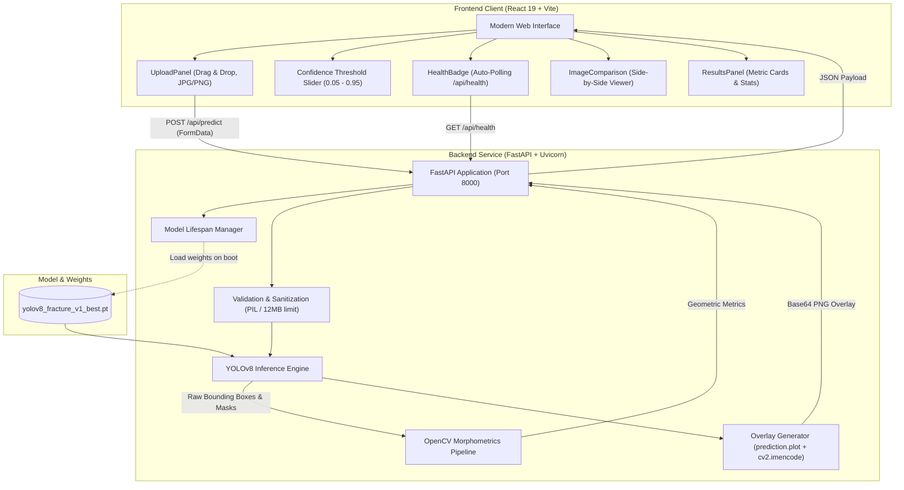
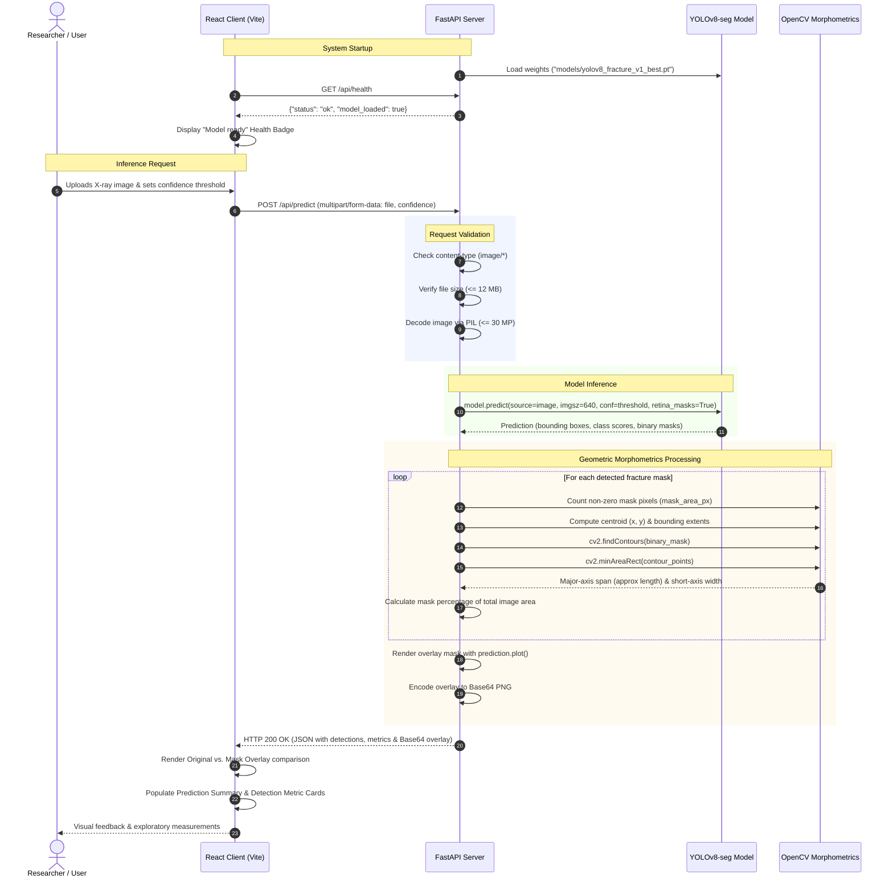

# FractureAI: Cross-Region Deep Fracture Segmentation & Quantitative Morphometric Analysis

> **Project Reference:** J26-IT-346 &middot; Component 4 Research Prototype  
> **Topic:** Cross-Region Deep Fracture Segmentation and Quantitative Morphometric Analysis  
> **Model Architecture:** YOLOv8-seg (Deep Learning Instance Segmentation)  
> **Application Stack:** FastAPI (Python 3.10+) &middot; React 19 &middot; Vite &middot; OpenCV

---

## 📋 Table of Contents
- [Overview](#-overview)
- [System Architecture](#-system-architecture)
- [System Flow & Data Pipeline](#-system-flow--data-pipeline)
- [Key Features](#-key-features)
- [Repository Structure](#-repository-structure)
- [API Reference](#-api-reference)
- [Morphometric Measurement Logic](#-morphometric-measurement-logic)
- [Getting Started](#-getting-started)
  - [Prerequisites](#prerequisites)
  - [1. Backend Setup](#1-backend-setup)
  - [2. Frontend Setup](#2-frontend-setup)
  - [3. Standalone Component Demo (Alternative)](#3-standalone-component-demo-alternative)
- [Scope & Clinical Disclaimer](#-scope--clinical-disclaimer)

---

## 🔬 Overview

**FractureAI (Component 4)** is a deep-learning-based computer vision system designed to detect, delineate, and extract morphometric properties of bone fractures from standard planar X-ray radiographs (JPG/PNG).

Developed as part of research project **J26-IT-346**, this component operates as a standalone research prototype focusing on:
1. **Precise Pixel-Level Segmentation:** Accurately tracing fracture lines and damaged regions using an optimized `YOLOv8-seg` instance segmentation model.
2. **Exploratory Morphometric Characterization:** Extracting geometric attributes such as mask surface area, centroid coordinates, bounding extent, major-axis span (region length), and minimum bounding box short-axis width.
3. **Interactive Clinical Research UI:** Providing clinicians and researchers with real-time confidence tuning, live side-by-side image comparison (original vs. segmentation mask overlay), and structured metric cards.

---

## 🏛 System Architecture

The application adopts a decoupled client-server architecture:



---

## 🔄 System Flow & Data Pipeline

The sequence diagram below details the end-to-end data lifecycle from user interaction to visual overlay display:



---

## ✨ Key Features

- **Automated Bone Fracture Segmentation:** Utilizes an instance segmentation model trained specifically on musculoskeletal X-rays to segment fracture contours.
- **Morphometric Feature Extraction:**
  - **Mask Area:** Quantified total non-zero pixel area (`px²`).
  - **Image Area Coverage:** Percentage of the radiograph affected by the predicted fracture region (`%`).
  - **Centroid Coordinates:** Mean spatial coordinate `(x, y)` of the fracture locus.
  - **Rotated Minimum Area Bounding Box (`cv2.minAreaRect`):**
    - **Major-Axis Span:** Proximate measurement representing the longitudinal extension of the fracture line.
    - **Short-Axis Width:** Orthogonal width proxy reflecting the transverse spread of the segmented region.
- **Interactive Web Interface:**
  - Dynamic drag-and-drop file upload with preview.
  - Granular confidence threshold tuning (slider from 5% to 95%).
  - Live side-by-side original radiograph and segmented mask overlay visualizer.
  - Automated backend health polling with status indicators.
- **Robust REST API:** Built with FastAPI, complete with auto-generated OpenAPI documentation (`/docs`), strict payload validation, and CORS support.

---

## 📁 Repository Structure

```text
prototype2/
└── J26-IT-346/
    ├── backend/
    │   ├── models/
    │   │   └── yolov8_fracture_v1_best.pt   # Pre-trained YOLOv8-seg weights
    │   ├── main.py                          # FastAPI server, endpoints, and CV2 pipeline
    │   └── requirements.txt                 # Backend Python dependencies
    ├── frontend/
    │   ├── public/                          # Static assets and icons
    │   ├── src/
    │   │   ├── assets/                      # Application brand assets
    │   │   ├── components/
    │   │   │   ├── ImageComparison.jsx      # Side-by-side original vs overlay viewer
    │   │   │   ├── ResultsPanel.jsx         # Metrics display cards & confidence bars
    │   │   │   └── UploadPanel.jsx          # Drag-and-drop upload & threshold slider
    │   │   ├── App.jsx                      # Main React orchestration component
    │   │   ├── index.css                    # Design system tokens and styling
    │   │   └── main.jsx                     # React entrypoint
    │   ├── index.html                       # HTML5 template
    │   ├── package.json                     # Frontend scripts and dependencies
    │   └── vite.config.js                   # Vite dev server & API proxy config
    └── component4_demo/
        ├── static/
        │   └── index.html                   # Single-page standalone demo interface
        └── README.md                        # Component 4 specific notes
```

---

## 📡 API Reference

### 1. Health Check
Checks backend operational status and confirms whether the segmentation model weights are loaded in memory.

- **URL:** `/api/health`
- **Method:** `GET`
- **Response:**
  ```json
  {
    "status": "ok",
    "model_loaded": true,
    "model": "yolov8_fracture_v1_best.pt"
  }
  ```

### 2. Predict Fracture Segmentation
Processes an uploaded radiograph and outputs segmentation masks, geometric metrics, and an overlay image.

- **URL:** `/api/predict`
- **Method:** `POST`
- **Content-Type:** `multipart/form-data`
- **Parameters:**
  | Parameter | Type | Required | Default | Description |
  | :--- | :--- | :--- | :--- | :--- |
  | `file` | Binary | Yes | - | X-ray image (`image/png` or `image/jpeg`, max 12 MB) |
  | `confidence` | Float | No | `0.25` | Detection threshold between `0.05` and `0.95` |

- **Sample Response:**
  ```json
  {
    "filename": "sample_xray.png",
    "image_width_px": 1024,
    "image_height_px": 1024,
    "confidence_threshold": 0.25,
    "prediction_count": 1,
    "detections": [
      {
        "class_name": "fractured",
        "confidence": 0.8742,
        "bbox_xyxy_px": [312.0, 420.5, 480.2, 590.1],
        "mask_area_px": 4820,
        "mask_extent": {
          "width_px": 168,
          "height_px": 170,
          "bbox_xyxy_px": [312, 420, 480, 590]
        },
        "approx_major_axis_span_px": 182.4,
        "approx_short_axis_width_px": 34.6,
        "mask_percent_of_image": 0.4597,
        "mask_centroid_px": {
          "x": 395.2,
          "y": 505.8
        }
      }
    ],
    "overlay_png_base64": "iVBORw0KGgoAAAANSUhEUgAA...",
    "measurement_note": "Estimated region length and short-axis width describe the predicted mask in image pixels...",
    "notice": "Research demonstration only. This output is not a medical diagnosis."
  }
  ```

---

## 📐 Morphometric Measurement Logic

The backend extracts morphological characteristics directly from the predicted segmentation mask using OpenCV:

1. **Mask Extraction:** The binary mask array is obtained from `prediction.masks.data` at original image resolution.
2. **Surface Area:** Calculated via `np.count_nonzero(binary_mask)` to determine the total pixel footprint.
3. **Centroid Coordinates:** Computed using the spatial averages of mask indices:
   $$\bar{x} = \frac{1}{N}\sum x_i, \quad \bar{y} = \frac{1}{N}\sum y_i$$
4. **Rotated Minimum Area Enclosing Box:** 
   - External contours are derived via `cv2.findContours(binary_mask, cv2.RETR_EXTERNAL, cv2.CHAIN_APPROX_SIMPLE)`.
   - The minimal oriented rectangle is determined with `cv2.minAreaRect(contour_points)`:
     - **Major-Axis Span:** $\max(\text{width}, \text{height})$ of the enclosing rectangle (proxy for fracture region length).
     - **Short-Axis Width:** $\min(\text{width}, \text{height})$ of the enclosing rectangle (proxy for fracture transverse thickness).

---

## 🚀 Getting Started

### Prerequisites

- **Python:** Version 3.10 or newer (tested with Python 3.11+)
- **Node.js:** Version 18.0 or newer (with `npm`)

---

### 1. Backend Setup

1. Open PowerShell / Command Prompt and navigate to the backend directory:
   ```powershell
   cd J26-IT-346\backend
   ```

2. Create and activate a Python virtual environment:
   ```powershell
   python -m venv .venv
   .\.venv\Scripts\Activate.ps1
   ```

3. Install required Python packages:
   ```powershell
   pip install -r requirements.txt
   ```

4. Verify that the model weight file exists:
   Ensure `models/yolov8_fracture_v1_best.pt` is present inside the `backend` folder.

5. Start the FastAPI development server:
   ```powershell
   uvicorn main:app --reload --port 8000
   ```
   * The API server will be available at: [http://127.0.0.1:8000](http://127.0.0.1:8000)
   * Interactive API docs (Swagger): [http://127.0.0.1:8000/docs](http://127.0.0.1:8000/docs)

---

### 2. Frontend Setup

1. In a separate terminal, navigate to the frontend directory:
   ```powershell
   cd J26-IT-346\frontend
   ```

2. Install dependencies:
   ```powershell
   npm install
   ```

3. Start the Vite development server:
   ```powershell
   npm run dev
   ```

4. Open your browser and navigate to:
   ```text
   http://localhost:5173
   ```
   *(Requests to `/api/*` are automatically proxied to `http://127.0.0.1:8000` via `vite.config.js`)*

---

### 3. Standalone Component Demo (Alternative)

If you wish to test Component 4 independently using its self-contained static interface:

```powershell
cd J26-IT-346
python -m uvicorn main:app --app-dir backend --reload
```
Then navigate to the frontend or open `component4_demo/static/index.html` in a web browser.

---

## ⚠️ Scope & Clinical Disclaimer

- **Research Demonstration Only:** This software is an experimental prototype built for academic and research evaluation. It is **not** certified as a diagnostic medical device and must **not** be used for primary clinical decision-making.
- **Single-Class Architecture:** The model predicts a single generic class (`fractured`) and does not identify anatomical regions (e.g., radius, ulna, femur, phalanges).
- **Pixel Units vs. Physical Metrics:** All measurements (area, bounding spans, centroids) are calculated in raw pixel units. Because standard radiographs lack integrated calibration markers in this demo, conversion to physical millimetres ($mm$) is not supported.
- **Short-Axis Proxy Note:** The short-axis metric represents the minimal dimension of the mask's enclosing bounding rectangle; it does **not** calculate true anatomical fracture gap or bone fragment displacement.
- **Privacy:** Images uploaded to the application are processed entirely in-memory and are not persisted to disk or external storage.
