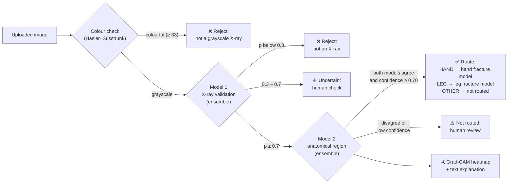
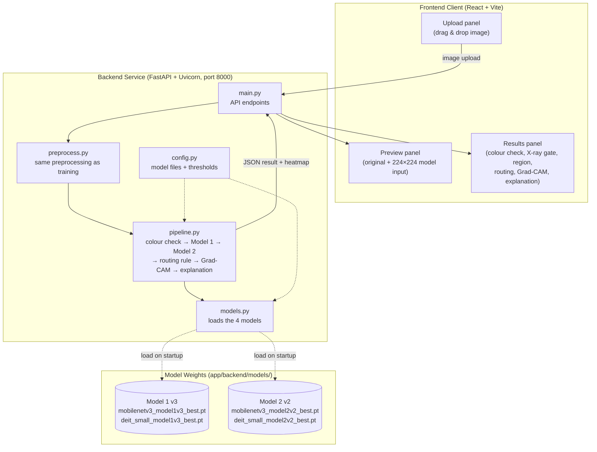
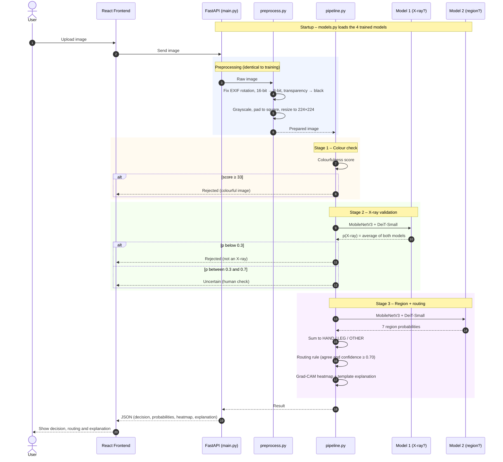
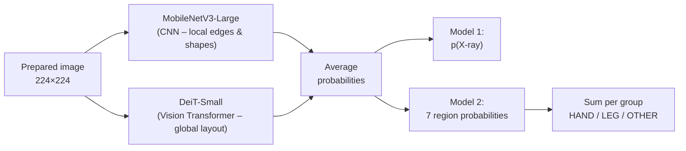
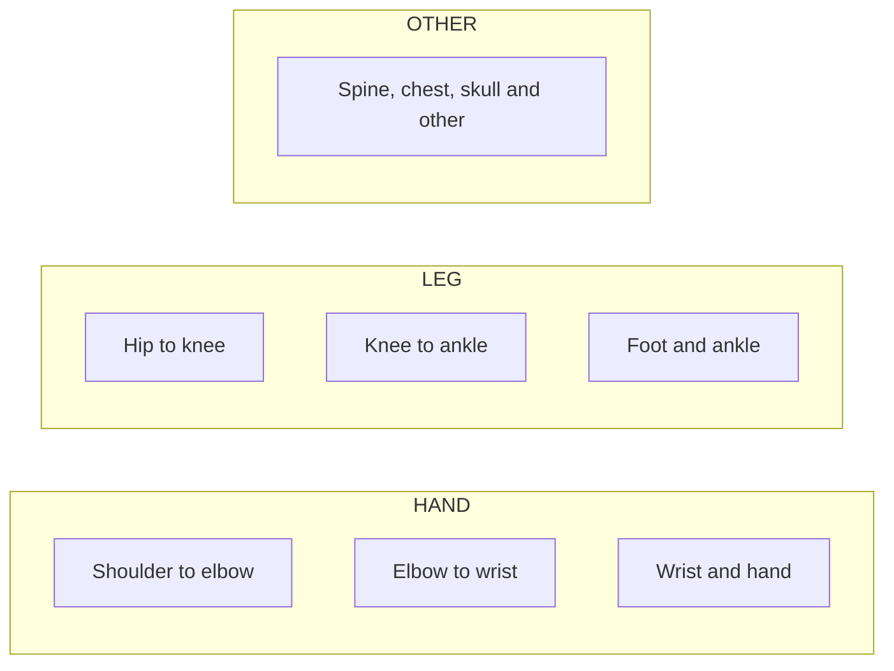
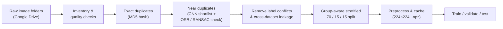
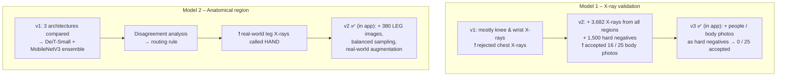

# BoneVision AI: X-ray Validation & Anatomical Region Classification

> **Project Reference:** J26-IT-346 &middot; Component 1 Research Prototype  
> **Topic:** X-ray Validation and Anatomical Region Classification (input gate + router for the fracture models)  
> **Model Architecture:** Ensembles of MobileNetV3-Large (CNN) + DeiT-Small (Vision Transformer) &middot; Grad-CAM XAI  
> **Application Stack:** FastAPI (Python) &middot; PyTorch &middot; timm &middot; React &middot; Vite

---

## 📋 Table of Contents
- [Overview](#-overview)
- [Decision Pipeline](#-decision-pipeline)
- [System Architecture](#-system-architecture)
- [System Flow & Data Pipeline](#-system-flow--data-pipeline)
- [Model Design](#-model-design)
- [Research Workflow & Model Evolution](#-research-workflow--model-evolution)
- [Key Results](#-key-results)
- [Key Features](#-key-features)
- [Repository Structure](#-repository-structure)
- [Getting Started](#-getting-started)
- [Limitations & Future Work (PP2)](#-limitations--future-work-pp2)
- [Scope & Clinical Disclaimer](#-scope--clinical-disclaimer)

---

## 🔬 Overview

**Component 1** is the **first stage** of the BoneVision AI pipeline. Every uploaded image passes through it
**before** any fracture model sees it. It answers three questions:

1. **Is this image an X-ray at all?** (rejects photos, CT, retina images, documents, etc.)
2. **Which body region is it?** (7 regions → grouped as **HAND / LEG / OTHER**)
3. **Where should it go?** HAND → hand fracture model, LEG → leg fracture model, OTHER → not routed.
   If the system is not sure, the image is sent for **human review** instead of being guessed.

Every decision comes with an **explanation**: a Grad-CAM heatmap showing where the model looked, plus a short
rule-based text explanation.

---

## 🚦 Decision Pipeline



| Step | Rule | Why |
|---|---|---|
| Colour check | colourfulness ≥ 33 → reject | Real X-rays are grayscale; a cheap check stops obvious photos early |
| Model 1 gate | ≥ 0.7 accept · 0.3–0.7 uncertain · below 0.3 reject | A three-way gate avoids forcing a yes/no on borderline images |
| Routing rule | route only if both models agree **and** confidence ≥ 0.70 | Wrong routing sends an image to the wrong fracture model, so unsure cases go to a human |

---

## 🏛 System Architecture

The application uses a decoupled client–server architecture:



---

## 🔄 System Flow & Data Pipeline

The sequence diagram below shows what happens from the moment a user uploads an image until the result is shown:



FastAPI also provides interactive API documentation at **http://localhost:8000/docs** while the backend is running.

---

## 🧠 Model Design

Both models use the same design: two different networks look at the same image and their probabilities are averaged
(a **heterogeneous CNN + transformer ensemble**).



**Model 2 – the 7 regions and how they are grouped:**



**Training setup (both models):** ImageNet-pretrained weights (transfer learning), AdamW (lr 1e-4) with cosine
schedule, class-weighted loss, augmentation (incl. low-resolution / JPEG degradation), best epoch chosen on the
**validation** set. Model 2 v2 adds balanced sampling (HAND 0.4 / LEG 0.4 / OTHER 0.2) and real-world augmentation
(strips, metal-like shapes, glare, perspective).

---

## 🧪 Research Workflow & Model Evolution

**Data preparation** (done before any training, documented in the notebooks):



**Each version fixed a problem found by testing on unseen images:**



---

## 📊 Key Results

### Model 1 – X-ray validation (unseen image sources)

| | v1 | v2 ensemble | **v3 ensemble** |
|---|---|---|---|
| Unseen-source test, % correct (221 images) | 85.5 | **96.4** | – |
| Unseen test incl. body photos, % correct (248 images) | – | 90.3 | **97.2** |
| Body photos accepted as X-ray | – | 16 / 25 | **0 / 25** |
| Three-way gate, wrong decisions (248) | – | 16 | **2** |

### Model 2 – Anatomical region (test set: 519 unseen images)

| Model | HAND/LEG/OTHER acc | 7-class acc | 7-class macro-F1 |
|---|---|---|---|
| MobileNetV3-Large | 97.9 % | 92.1 % | 0.891 |
| EfficientNetV2-S | 94.4 % | 86.5 % | 0.812 |
| DeiT-Small | 98.5 % | 93.6 % | 0.920 |
| **Ensemble (DeiT + MobileNetV3)** | **98.7 %** (95 % CI 97.5–99.6) | 92.7 % | 0.898 |

| v1 → v2 (LEG bias fix) | v1 ensemble | **v2 ensemble** |
|---|---|---|
| Old test (519): wrongly routed | 4 | **1** |
| Newtest (130 held-back LEG images): correct | 93.8 % | **98.5 %** |
| Newtest: routed / wrongly routed | 67.7 % / 5 | **99.2 % / 2** |

### Explainability (XAI) checks
- Grad-CAM, Grad-CAM++ and Integrated Gradients agree: attention lies on the correct anatomy for all 7 classes.
- **Resolution shortcut test:** degraded limb images are still not predicted as OTHER → no "blurry = chest" shortcut.
- **Annotation test:** drawn arrows/circles receive less attention than their size → the model does not rely on them.

Full result tables: [`component1-xray-validation/README.md`](component1-xray-validation/README.md) and
[`component1-xray-validation/results/README.md`](component1-xray-validation/results/README.md).

---

## ✨ Key Features

- **Three-stage input gate:** colour check → X-ray validation → anatomical region, each with a clear reject /
  uncertain / accept outcome.
- **Safe routing:** an image is routed only when both models agree and confidence ≥ 0.70; otherwise human review.
- **CNN + Transformer ensembles:** MobileNetV3-Large and DeiT-Small combine local and global image features.
- **Explainable output:**
  - Grad-CAM heatmap (MobileNetV3) showing where the model looked.
  - Rule-based text explanation (e.g. *"Classified as a LEG X-ray … The model's attention is strongest in the … part"*).
- **Training-identical preprocessing:** the app prepares images exactly like the training data.
- **Leakage-aware evaluation:** duplicate detection, group-aware splits, held-back and unseen-source test sets.
- **VLM prototype (notebook only):** Qwen2-VL-2B-Instruct text explanations with a blind check; not used in the app yet.

---

## 📁 Repository Structure

```text
J26-IT-346/                                (branch: x-ray-validation-and-anatomical-region-classification)
├── README.md                              # This file
└── component1-xray-validation/
    ├── README.md                          # Detailed results and data-preparation notes
    ├── notebooks/
    │   ├── model1/                        # 01–08: X-ray validation (data prep, v1 → v3, unseen tests)
    │   ├── model2/                        # 01–07: region classification (data prep, comparison,
    │   │                                  #        disagreement analysis, v1 → v2)
    │   ├── xai/                           # 01: Grad-CAM, Grad-CAM++, Integrated Gradients, shortcut tests
    │   └── vlm/                           # 01: VLM prototype (Qwen2-VL-2B-Instruct)
    ├── results/                           # Summary result tables and charts
    │   ├── model1_v2/                     # Model 1 v2 results
    │   ├── model1_v3/                     # Model 1 v3 results
    │   ├── model2/                        # Model 2 v1 model comparison + charts
    │   ├── model2_v2/                     # Model 2 v1 vs v2 comparison + chart
    │   └── README.md                      # Explains every result file
    └── app/
        ├── backend/
        │   ├── app/
        │   │   ├── __init__.py
        │   │   ├── main.py                # FastAPI server and endpoints
        │   │   ├── config.py              # Model file names and thresholds
        │   │   ├── models.py              # Loads the 4 trained models
        │   │   ├── preprocess.py          # Training-identical preprocessing
        │   │   └── pipeline.py            # Colour check, Model 1, Model 2, routing, Grad-CAM, explanation
        │   ├── models/                    # The 4 model weights used by the app (.pt)
        │   ├── check_image.py             # Test one image from the command line
        │   └── requirements.txt           # Python dependencies
        └── frontend/
            ├── src/
            │   ├── components/
            │   │   ├── UploadPanel.jsx    # Drag-and-drop image upload
            │   │   ├── PreviewPanel.jsx   # Original image + 224×224 model input
            │   │   ├── ResultsPanel.jsx   # Colour check, X-ray gate, region, routing, Grad-CAM, explanation
            │   │   ├── Bars.jsx           # Probability bars
            │   │   ├── Icons.jsx          # UI icons
            │   │   └── ValidationCard.jsx, RegionCard.jsx, ExplanationCard.jsx   # earlier card layout (not used now)
            │   ├── App.jsx                # Main page layout
            │   ├── api.js                 # Sends the image to the backend
            │   ├── main.jsx               # React entry point
            │   └── styles.css             # Styling
            ├── index.html
            ├── package.json
            └── vite.config.js
```

---

## 🚀 Getting Started

### Prerequisites
- **Python** 3.10 or newer
- **Node.js** 18 or newer (with `npm`)

### 1. Backend Setup

```powershell
cd component1-xray-validation\app\backend
python -m venv .venv
.\.venv\Scripts\Activate.ps1        # macOS/Linux: source .venv/bin/activate
pip install -r requirements.txt
uvicorn app.main:app --reload --port 8000
```

- API: http://localhost:8000
- Interactive API docs (Swagger): http://localhost:8000/docs
- The 4 model weights are already included in `app/backend/models/`.

### 2. Frontend Setup (second terminal)

```powershell
cd component1-xray-validation\app\frontend
npm install
npm run dev
```

Open **http://localhost:5173** in your browser.

### 3. Quick Check Without the UI

```powershell
cd component1-xray-validation\app\backend
python check_image.py <path-to-image>
```

### 4. Running the Notebooks
Open a notebook in **Google Colab** (T4 GPU for training), set the paths in its *Settings* cell to your Google
Drive `Research/` folder and run top to bottom. Datasets and caches are kept in Google Drive, not in this repository.

---

## 🔭 Limitations & Future Work (PP2)

**Current limitations**
- No patient IDs → duplicates are found from image content; copies below the detection threshold may remain.
- LEG and non-chest OTHER (spine, skull) are still smaller classes than HAND.
- Real-world tests (metal implants, phone photos of X-rays) are small → a larger real-world test set is needed.
- Tinted/coloured X-rays are rejected by the colour check; skull and animal X-rays are usually "uncertain".
- The Model 1 three-way band was informed by the unseen test → to be confirmed on a new unseen set.
- VLM descriptions still contain anatomical errors.

**Planned for PP2**
- Image quality assessment and enhancement
- Laterality (left / right) and view (AP / lateral) classification
- VLM fine-tuning and evaluation, shown only as an *unverified* extra next to the template explanation
- Integration with the hand and leg fracture components

---

## ⚠️ Scope & Clinical Disclaimer

- **Research demonstration only:** this is an academic prototype. It is **not** a certified medical device and must
  **not** be used for clinical decisions.
- **Not a fracture detector:** Component 1 only checks that the image is an X-ray and identifies the body region;
  fracture detection is done by the other BoneVision AI components.
- **Explanations are aids, not proof:** Grad-CAM shows where the model looked, not why it is medically correct.
- **No patient data in this repository:** images, datasets and caches are not included; only code, summary
  results and the 4 app model weights.
