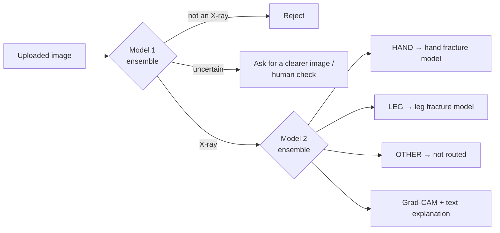

# Component 1 – X-ray Validation and Anatomical Region Classification

**BoneVision AI · J26-IT-346** — first stage of the pipeline. Every uploaded image is checked here before any
fracture model sees it:

1. **Model 1 – X-ray validation:** is this image an X-ray at all? (X-ray / not an X-ray / uncertain)
2. **Model 2 – Anatomical region:** which body region? 7 fine classes → routed as **HAND / LEG / OTHER**
3. **XAI:** Grad-CAM, Grad-CAM++ and Integrated Gradients show *where* the model looked
4. **VLM prototype:** a short text explanation ("This is a LEG X-ray because …")

---

## Results

### Model 1 – X-ray validation

**Unseen-source test** (image sources never used in training; the v1 test images were rebuilt exactly with the
same code and seed – v1 predictions reproduced with max difference 0.0):

| Group (n) | v1 | v2 MobileNetV3 | v2 DeiT-Small | **v2 Ensemble** |
|---|---|---|---|---|
| Chest X-ray – PneumoniaMNIST (60) | 65.0 | 100 | 100 | **100** |
| CT – OrganCMNIST (50) | 100 | 94.0 | 96.0 | 94.0 |
| Retina photo – RetinaMNIST (40) | 77.5 | 97.5 | 87.5 | 95.0 |
| Flower photo – Flowers102 (40) | 97.5 | 92.5 | 92.5 | 92.5 |
| Text document, synthetic (20) | 100 | 100 | 100 | 100 |
| Real dental X-ray photos (11) | 90.9 | 81.8 | 100 | **100** |
| **Overall, % correct (221)** | **85.5** | **95.9** | **95.5** | **96.4** |

Three-way gate (p ≥ 0.7 X-ray, p < 0.3 not an X-ray, otherwise *uncertain*): the v2 ensemble makes **2 wrong
decisions out of 221** and sends 13 images (5.9 %) to *uncertain*; v1 makes 15 wrong decisions, with 29 uncertain.

**In-source test** (v2 test set, 1,263 images): v1 accuracy 97.5 % (FRR 3.4 % – rejected 16 / 70 chest, spine and
skull X-rays); v2 MobileNetV3 99.9 %; v2 DeiT-Small and the ensemble 100 %.

**What changed from v1 to v2:** v1 had almost no X-ray variety (mostly knee and wrist), so it rejected chest X-rays.
v2 adds 3,682 X-rays from all regions (Model 2 data, same split) plus 1,500 hard negatives (OCT scans, skin photos,
blood microscopy, everyday objects), after a cross-source duplicate check against the Model 2 data.

### Model 2 – Anatomical region (test set: 519 unseen images)

| Model | HAND/LEG/OTHER acc | 7-class acc | 7-class macro-F1 | Size | ms / img (T4) |
|---|---|---|---|---|---|
| MobileNetV3-Large | 97.9 % | 92.1 % | 0.891 | 17 MB | 12.2 |
| EfficientNetV2-S | 94.4 % | 86.5 % | 0.812 | 82 MB | 18.4 |
| DeiT-Small | 98.5 % | 93.6 % | 0.920 | 87 MB | 5.6 |
| **Ensemble (DeiT + MobileNetV3)** | **98.7 %** (95 % CI 97.5–99.6) | 92.7 % | 0.898 | 104 MB | ~18 |

- All models trained with the same data, augmentation and settings; ensemble members chosen on the **validation** set.
- Most errors fall between neighbouring regions (elbow-to-wrist ↔ wrist-and-hand) and stay inside HAND.
- Weak spot: non-chest OTHER (spine, skull) – only 59 training images.

### XAI checks (Model 2)

- Grad-CAM, Grad-CAM++ and Integrated Gradients agree; attention lies on the correct anatomy for all 7 classes.
- **Resolution shortcut test:** limb images degraded to 128 px / 64 px (like the low-resolution chest images) are
  still not predicted as OTHER (0.2 % MobileNetV3, 0.0 % DeiT) → no "blurry = chest" shortcut.
- **Annotation test:** drawn coloured arrows/circles cover 0.5 % of the image but receive 0.2 % of the attention
  (median ratio 0.41) → the model does not rely on them.
- DeiT Grad-CAM is noisier on the background (ratio 0.60 vs 0.09), but its Integrated Gradients lie on the same
  bones → MobileNetV3 Grad-CAM is used for user-facing explanations.

### VLM prototype

Qwen2-VL-2B-Instruct (ready-made, not fine-tuned). The classifier decides; the VLM only explains, plus an
independent *blind* check of the region (VLM alone: 95.7 % HAND/LEG/OTHER, 74.3 % 7-class on 70 test images).
A rule-based template explanation is always shown; the VLM description is marked *unverified*.

---

## Data preparation highlights

- **Duplicates:** perceptual hashing and image correlation failed (layout dominated), so a CNN shortlist plus
  ORB keypoints with RANSAC verification was used, validated on hand-labelled pairs. 592 images in the Model 2 data
  have at least one copy (contrast-enhanced, mirrored, rotated, cropped); copies are kept in the same split.
- **Label conflicts:** 30 identical images carried different labels and were excluded (list shared with the team).
- **Leakage across datasets:** 126 Model 1 v1 X-rays were near-duplicates of Model 2 images (some crossing
  train/test) and were removed from Model 1 v2.
- Group-aware stratified 70 / 15 / 15 splits; all decisions documented inside the notebooks.

---

## Repository contents

| Notebook | Purpose |
|---|---|
| `notebooks/model1/01_data_preparation` | Model 1 v1 data, group-aware split (baseline) |
| `notebooks/model1/02_train_model1` | Model 1 v1 training, Grad-CAM, first unseen-source test |
| `notebooks/model1/03_data_preparation_v2` | v2 data: hard negatives, cross-source duplicate check |
| `notebooks/model1/04_train_v2` | v2 MobileNetV3 + DeiT-Small, in-source test vs v1 |
| `notebooks/model1/05_unseen_test` | v1 vs v2 on the rebuilt unseen test, three-way gate |
| `notebooks/model2/01_data_preparation` | inventory, quality checks, duplicate detection, split |
| `notebooks/model2/02_train_model2` | MobileNetV3, 7 classes → HAND / LEG / OTHER |
| `notebooks/model2/03_compare_models` | EfficientNetV2-S, DeiT-Small, ensemble |
| `notebooks/xai/01_xai_model2` | Grad-CAM, Grad-CAM++, Integrated Gradients, shortcut tests |
| `notebooks/vlm/01_vlm_prototype` | grounded text explanations + blind check |

**How to run:** open a notebook in Google Colab (T4 GPU for training), set the paths in its *Settings* cell to your
Google Drive `Research/` folder and run top to bottom. Notebooks are re-runnable from the Drive folders
(folder names = labels).

**Not included:** images, datasets and model weights (`.npz`, `.pt`) are kept in Google Drive and excluded from
this public repository. Public datasets used include MedMNIST (OrganAMNIST, BreastMNIST, ChestMNIST, OCTMNIST,
DermaMNIST, BloodMNIST, and PneumoniaMNIST / OrganCMNIST / RetinaMNIST for testing only), Imagenette and Flowers102.

---

## Limitations and next steps

- No patient IDs → duplicate groups are found from image content; copies below the detection threshold may remain.
- Non-chest OTHER (spine, skull) is under-represented → add spine and dental X-rays.
- Model 1 three-way band and ensemble choice were informed by the unseen test → confirm on a new unseen set.
- Policy for inverted and photographed X-rays to be agreed with the team.
- VLM descriptions still contain anatomical errors → medical fine-tuning is future work.

---
