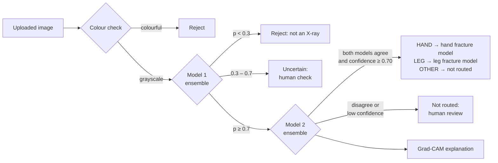

# Component 1 – X-ray Validation and Anatomical Region Classification

**BoneVision AI · J26-IT-346** — first stage of the pipeline. Every uploaded image is checked here before any
fracture model sees it:

1. **Colour check:** real X-rays are grayscale; clearly colourful images (Hasler–Süsstrunk colourfulness ≥ 33) are rejected
2. **Model 1 – X-ray validation:** is this image an X-ray at all? (X-ray / not an X-ray / uncertain)
3. **Model 2 – Anatomical region:** which body region? 7 fine classes → routed as **HAND / LEG / OTHER**
4. **XAI:** Grad-CAM shows *where* the model looked (Grad-CAM++ and Integrated Gradients used for checks)
5. **VLM prototype (notebook only):** a short text explanation ("This is a LEG X-ray because …")



**Final models used in the app:** Model 1 **v3** and Model 2 **v2** (each an ensemble of MobileNetV3-Large + DeiT-Small).

---

## Results

### Model 1 – X-ray validation

**v1 → v2.** v1 had almost no X-ray variety (mostly knee and wrist), so it rejected chest X-rays.
v2 adds 3,682 X-rays from all regions (Model 2 data, same split) plus 1,500 hard negatives (OCT scans, skin photos,
blood microscopy, everyday objects), after a cross-source duplicate check against the Model 2 data.

**Unseen-source test** (image sources never used in training; the v1 test images were rebuilt exactly with the
same code and seed – v1 predictions reproduced with max difference 0.0):

| Group (n) | v1 | v2 MobileNetV3 | v2 DeiT-Small | **v2 Ensemble** |
|---|---|---|---|---|
| Chest X-ray – PneumoniaMNIST (60) | 65.0 | 100 | 100 | **100** |
| CT – OrganCMNIST (50) | 100 | 94.0 | 96.0 | 94.0 |
| Retina photo – RetinaMNIST (40) | 77.5 | 97.5 | 87.5 | 95.0 |
| Flower photo – Flowers102 (40) | 97.5 | 92.5 | 92.5 | 92.5 |
| Text document, synthetic (20) | 100 | 100 | 100 | 100 |
| Real dental X-ray photos (11) | 90.9 | 81.8 | 100 | **100** |
| **Overall, % correct (221)** | **85.5** | **95.9** | **95.5** | **96.4** |

**v2 → v3.** Real-world testing showed v2 accepting photos of people's hands and bodies as X-rays
(16 / 25 internet body photos). v3 adds photos of people and body parts as hard negatives.

| | v2 ensemble | **v3 ensemble** |
|---|---|---|
| Unseen test incl. body photos, % correct (248) | 90.3 | **97.2** |
| Body photos accepted as X-ray | 16 / 25 | **0 / 25** |
| Three-way gate (≥ 0.7 / < 0.3), wrong decisions (248) | 16 | **2** |
| In-source test (1,503 images) | 98.9 % (accepted 14 / 90 hand photos) | **100 %** |

Trade-off: v3 is more cautious on phone photos of X-rays (dental: 5 accepted, 5 uncertain, 1 rejected).

### Model 2 – Anatomical region

**v1 – model comparison** (test set: 519 unseen images):

| Model | HAND/LEG/OTHER acc | 7-class acc | 7-class macro-F1 | Size | ms / img (T4) |
|---|---|---|---|---|---|
| MobileNetV3-Large | 97.9 % | 92.1 % | 0.891 | 17 MB | 12.2 |
| EfficientNetV2-S | 94.4 % | 86.5 % | 0.812 | 82 MB | 18.4 |
| DeiT-Small | 98.5 % | 93.6 % | 0.920 | 87 MB | 5.6 |
| **Ensemble (DeiT + MobileNetV3)** | **98.7 %** (95 % CI 97.5–99.6) | 92.7 % | 0.898 | 104 MB | ~18 |

- All models trained with the same data, augmentation and settings; ensemble members chosen on the **validation** set.
- Most errors fall between neighbouring regions (elbow-to-wrist ↔ wrist-and-hand) and stay inside HAND.

**Routing rule (added after a disagreement analysis, notebook 04):** an image is routed only if both models agree
on HAND/LEG/OTHER **and** ensemble confidence ≥ 0.70; otherwise it is "uncertain – human review".
On the test set, wrongly routed images dropped from 7 to 4, with 2–3 % sent to review.

**v1 → v2 (LEG bias fix).** Real-world tests showed v1 calling clear leg X-rays HAND; MobileNetV3 alone called only
66.2 % of new LEG images LEG. v2 adds 380 new LEG images (after exact and near-duplicate removal, 130 held back as
*newtest*), uses balanced sampling (HAND 0.4 / LEG 0.4 / OTHER 0.2) and real-world augmentations
(strips, metal-like shapes, glare, perspective). The decision rule was fixed before testing.

| | v1 ensemble | **v2 ensemble** |
|---|---|---|
| Old test (519): HAND/LEG/OTHER correct | 98.7 % | 98.7 % |
| Old test: wrongly routed / sent to review | 4 / 13 | **1** / 20 |
| Newtest (130 held-back LEG images): correct | 93.8 % | **98.5 %** |
| Newtest: routed / wrongly routed | 67.7 % / 5 | **99.2 % / 2** |
| MobileNetV3 alone on newtest | 66.2 % | **97.7 %** |

### XAI checks (Model 2)

- Grad-CAM, Grad-CAM++ and Integrated Gradients agree; attention lies on the correct anatomy for all 7 classes.
- **Resolution shortcut test:** limb images degraded to 128 px / 64 px (like the low-resolution chest images) are
  still not predicted as OTHER (0.2 % MobileNetV3, 0.0 % DeiT) → no "blurry = chest" shortcut.
- **Annotation test:** drawn coloured arrows/circles cover 0.5 % of the image but receive 0.2 % of the attention
  (median ratio 0.41) → the model does not rely on them.
- DeiT Grad-CAM is noisier on the background (ratio 0.60 vs 0.09), but its Integrated Gradients lie on the same
  bones → MobileNetV3 Grad-CAM is used for user-facing explanations.

### VLM prototype

Qwen2-VL-2B-Instruct (ready-made, not fine-tuned). The classifier decides; the VLM only explains, plus an
independent *blind* check of the region (VLM alone: 95.7 % HAND/LEG/OTHER, 74.3 % 7-class on 70 test images).
A rule-based template explanation is always shown; the VLM description is marked *unverified*. Not used in the app yet.

---

## Data preparation highlights

- **Duplicates:** perceptual hashing and image correlation failed (layout dominated), so a CNN shortlist plus
  ORB keypoints with RANSAC verification was used, validated on hand-labelled pairs. 592 images in the Model 2 data
  have at least one copy (contrast-enhanced, mirrored, rotated, cropped); copies are kept in the same split.
- **Label conflicts:** 30 identical images carried different labels and were excluded (list shared with the team).
- **Leakage across datasets:** 126 Model 1 v1 X-rays were near-duplicates of Model 2 images (some crossing
  train/test) and were removed from Model 1 v2. New Model 2 v2 images were checked the same way against all existing data.
- Group-aware stratified 70 / 15 / 15 splits; all decisions documented inside the notebooks.

---

## Repository contents

| Notebook | Purpose |
|---|---|
| `notebooks/model1/01_data_preparation` | Model 1 v1 data, group-aware split (baseline) |
| `notebooks/model1/02_train_model1` | Model 1 v1 training, Grad-CAM, first unseen-source test |
| `notebooks/model1/03_data_preparation_v2` | v2 data: hard negatives, cross-source duplicate check |
| `notebooks/model1/04_train_v2` | v2 MobileNetV3 + DeiT-Small, in-source test vs v1 |
| `notebooks/model1/05_unseen_test` | v1 vs v2 on the rebuilt unseen test, three-way gate |
| `notebooks/model1/06_data_preparation_v3` | v3 data: body/people photos as hard negatives |
| `notebooks/model1/07_train_v3` | v3 training, in-source test vs v2 |
| `notebooks/model1/08_unseen_test_v3` | v2 vs v3 on unseen sources + real-world photos |
| `notebooks/model2/01_data_preparation` | inventory, quality checks, duplicate detection, split |
| `notebooks/model2/02_train_model2` | MobileNetV3, 7 classes → HAND / LEG / OTHER |
| `notebooks/model2/03_compare_models` | EfficientNetV2-S, DeiT-Small, ensemble |
| `notebooks/model2/04_disagreement_analysis` | when the two models disagree → routing rule |
| `notebooks/model2/05_data_v2` | new LEG images, duplicate check, label fixes, newtest split |
| `notebooks/model2/06_train_v2_balanced` | v2 training with balanced sampling + real-world augmentation |
| `notebooks/model2/07_compare_v1_v2` | v1 vs v2 on old test and newtest |
| `notebooks/xai/01_xai_model2` | Grad-CAM, Grad-CAM++, Integrated Gradients, shortcut tests |
| `notebooks/vlm/01_vlm_prototype` | grounded text explanations + blind check |

Other folders: `app/` (web app, below) and `results/` (summary CSV tables, see `results/README.md`).

**How to run the notebooks:** open a notebook in Google Colab (T4 GPU for training), set the paths in its
*Settings* cell to your Google Drive `Research/` folder and run top to bottom.

---

## Running the app

FastAPI backend + React (Vite) frontend. The 4 trained models are included in `app/backend/models/`.

```bash
# Backend (http://localhost:8000)
cd app/backend
python -m venv .venv
.venv\Scripts\activate          # Windows (macOS/Linux: source .venv/bin/activate)
pip install -r requirements.txt
uvicorn app.main:app --reload --port 8000

# Frontend (http://localhost:5173) – in a second terminal
cd app/frontend
npm install
npm run dev
```

Quick check without the UI: `python check_image.py <image>` inside `app/backend`.

---

## What is (and is not) in this repository

- **Included:** notebooks, app code, summary result tables, and the 4 model weights used by the app
  (`mobilenetv3_model1v3_best.pt`, `deit_small_model1v3_best.pt`, `mobilenetv3_model2v2_best.pt`,
  `deit_small_model2v2_best.pt`).
- **Not included:** images, datasets, caches (`.npz`) and all other model versions – kept in Google Drive.
  Public datasets used include MedMNIST (OrganAMNIST, BreastMNIST, ChestMNIST, OCTMNIST, DermaMNIST, BloodMNIST,
  and PneumoniaMNIST / OrganCMNIST / RetinaMNIST for testing only), Imagenette and Flowers102.

---

## Limitations and next steps

- No patient IDs → duplicate groups are found from image content; copies below the detection threshold may remain.
- LEG and non-chest OTHER (spine, skull) are still smaller than HAND (train: HAND 1,833 / LEG 645 / OTHER 345).
- Model 2 v2 remaining errors include an axial (skyline) patella view; one source "leg" image is actually an elbow (label error).
- Real-world tests (metal implants, phone photos) are small and informal → a larger real-world test set is needed.
- Tinted/coloured X-rays are rejected by the colour check; skull and animal X-rays are usually "uncertain".
- Model 1 three-way band was informed by the unseen test → confirm on a new unseen set.
- VLM descriptions still contain anatomical errors → medical fine-tuning is future work.
- **PP2:** image quality assessment, enhancement, laterality (left/right) and view (AP/lateral) classification.